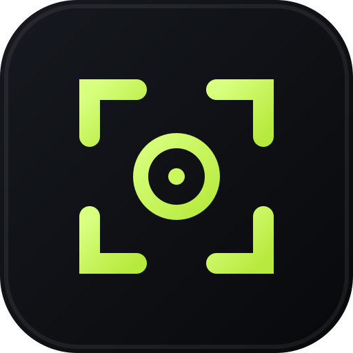
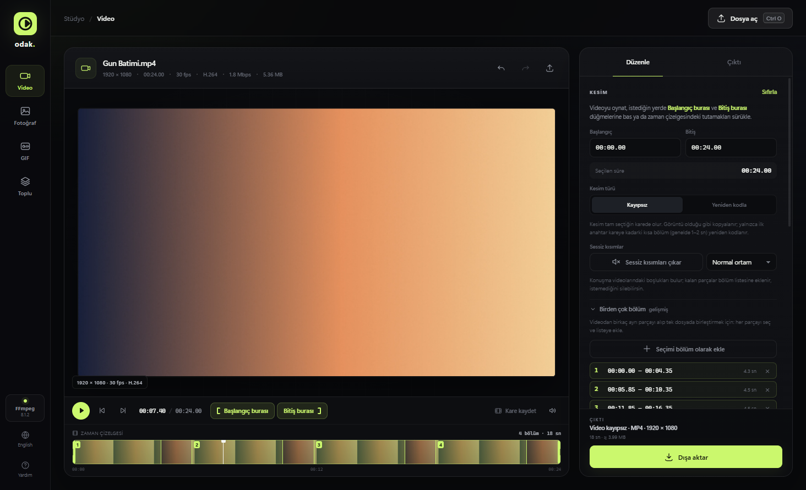
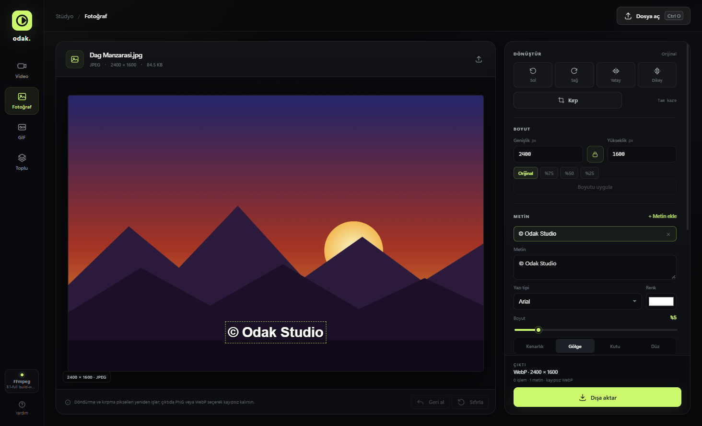
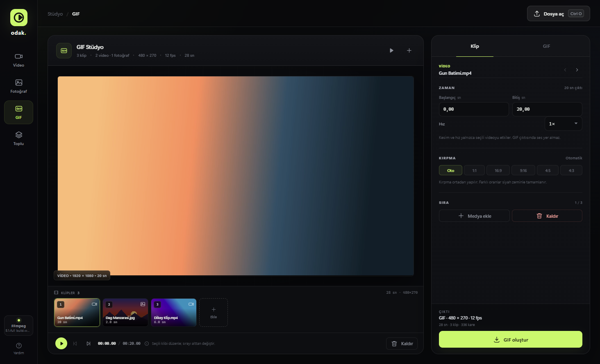
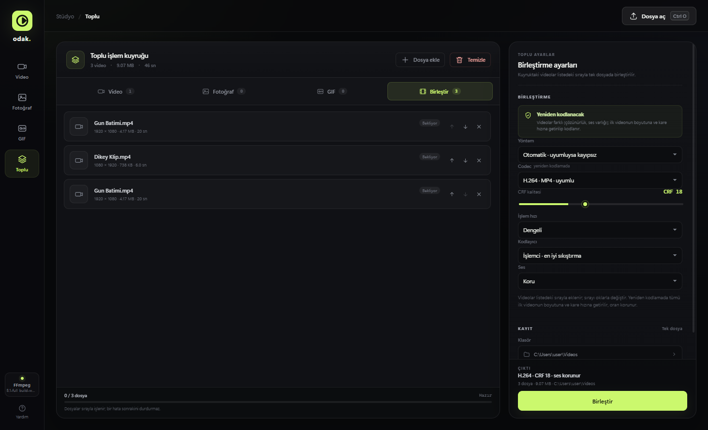

<div align="center">



# Odak Studio

**Kaliteden ödün vermeyen, ücretsiz ve açık kaynak video, fotoğraf ve GIF stüdyosu.**
Kurulum yeter; hesap, reklam, filigran veya abonelik yok. Dosyaların bilgisayarından hiç çıkmaz.

[](https://github.com/EfeKesgin/odak-studio/releases/latest)
[](LICENSE)


### [⬇ Windows için indir](https://github.com/EfeKesgin/odak-studio/releases/latest)

<sub>Sürüm sayfasındaki <code>OdakStudio-Setup-….exe</code> dosyasını indirip çalıştır. Yeni sürümler uygulama içinden kendiliğinden gelir.</sub>

</div>



## Neler yapabilir?

| | |
| --- | --- |
| **Video** | Kolay kesim: oynat, "Başlangıç burası" / "Bitiş burası" de, dışa aktar. Tam kesim ya da hızlı kayıpsız kesim; çok bölümlü kesim, kırpma, döndürme, boyutlandırma, hız. H.264 / H.265 / VP9 / ProRes. |
| **Hedef boyut** | "Bu video 10 MB olsun" de, gerisini o halletsin: Discord, WhatsApp, e-posta için hazır ayarlar. |
| **Metin ve altyazı** | Videoya, fotoğrafa ve GIF'e yazı veya filigran; altyazıyı videoya yakma. |
| **Hız** | NVIDIA, Intel ve AMD ekran kartlarıyla birkaç kat daha hızlı kodlama (varsa). |
| **Fotoğraf** | Kırp, döndür, boyutlandır; JPEG, PNG, WebP, AVIF, TIFF. Renk profili ve EXIF korunur. |
| **GIF** | Video ve fotoğraflardan GIF; klip sırası, kırpma, hız, FPS, üst/alt yazı. |
| **Toplu işlem** | Yüzlerce dosyayı aynı ayarla dönüştür; videoları tek dosyada birleştir. |
| **Kolay kullanım** | Gezginde sağ tık → **Birlikte aç → Odak Studio**; videoda geri al / yinele (Ctrl+Z / Ctrl+Y). |
| **Dil** | Türkçe ve İngilizce arayüz. |

<table>
  <tr>
    <td></td>
    <td></td>
  </tr>
  <tr>
    <td align="center"><sub>Fotoğrafa filigran</sub></td>
    <td align="center"><sub>GIF stüdyosu</sub></td>
  </tr>
  <tr>
    <td colspan="2"></td>
  </tr>
  <tr>
    <td colspan="2" align="center"><sub>Farklı boyuttaki videoları tek dosyada birleştirme</sub></td>
  </tr>
</table>

## Neden güvenilir?

- **Açık kaynak:** Kodun tamamı bu sayfada; ne yaptığını herkes görebilir ve denetleyebilir.
- **İnternete bir şey göndermez:** Tüm işlemler senin bilgisayarında yapılır. Uygulamanın
  internete tek bağlantısı, açılışta GitHub'da yeni sürüm olup olmadığına bakmaktır (internet
  yoksa uygulama normal çalışır).
- **Gizli ücret yok:** Deneme süresi, filigran, kısıtlı özellik veya hesap yok.
- **Sorun olursa:** Yardım → **Hata kaydını aç** ile oluşan kayıt dosyasını bir
  [sorun bildirimi](https://github.com/EfeKesgin/odak-studio/issues) ile paylaşabilirsin. Kayıt
  yalnızca senin bilgisayarında tutulur, hiçbir yere gönderilmez.

### Windows "tanınmayan uygulama" uyarısı

Odak Studio ücretsiz bir proje olduğu için kurulum dosyası ücretli bir kod imzalama
sertifikasıyla imzalanmamıştır. Bu yüzden Windows SmartScreen ilk kurulumda bir uyarı
gösterebilir: **Ek bilgi → Yine de çalıştır**'a tıklayarak devam edebilirsin. Dosyayı yalnızca bu
sayfadaki [Sürümler](https://github.com/EfeKesgin/odak-studio/releases) bölümünden indir.

## English

**Odak Studio** is a free, open-source, quality-first video, photo and GIF studio for Windows.
Lossless trimming, multi-segment cuts, target file size (e.g. "fit into 10 MB"), text and
watermarks, subtitle burn-in, GPU encoding (NVENC / Quick Sync / AMF), batch conversion and video
merging. Everything runs locally; no account, ads or watermarks. The interface is available in
English and Turkish (Help → Language).
[Download for Windows](https://github.com/EfeKesgin/odak-studio/releases/latest).

---

## Geliştiriciler için

Aşağıdaki bölümler projeyi kaynaktan çalıştırmak, paketlemek ve katkıda bulunmak içindir.

### Teknik ayrıntılar

- **Videoda kalite koruması:** Görsel değişiklik yoksa (kesim dışında) akış kopyalama (stream copy)
  ile yeniden kodlama yapılmaz. Yeniden kodlama gerekliyse varsayılan CRF 16 kullanılır. Ek ses
  dilleri ve altyazı izleri çıktıya taşınır.
- **Hedef dosya boyutu:** İki geçişli kodlama; çıktı hedefi aşarsa bir kez daha düşük bit hızıyla
  düzeltilir. Hedef bir üst sınırdır: kısa veya zaten küçük videolar şişirilmez (bit hızı kaynağı
  aşmaz). GPU'da kodlayıcının kendi çok geçişli modu kullanılır.
- **Çok bölümlü kesim:** `I` / `O` ile giriş/çıkış noktası, `B` ile seçimi bölüm olarak ekleme.
  Kopya modunda bölümler ayrı kesilip concat ile, yeniden kodlamada tek filtre grafiğinde birleşir.
- **Metin katmanları:** Video ve GIF'te libass (ASS), fotoğrafta SVG ile çizilir; önizleme ile
  çıktının aynı görünmesi için yazı tipi oranları ölçülerek ayarlanmıştır.
- **Donanım kodlama:** Açılışta her GPU kodlayıcı gerçek bir deneme kodlamasıyla test edilir;
  çalışmayanlar sunulmaz.
- **Hazır ayarlar ve tercihler** kullanıcı veri klasöründeki `config.json`'da tutulur.
- **Fotoğraf:** 16-bit kaynak desteği, ICC profili koruması (ör. Display P3), EXIF yönlendirmesi.
  Biçim değişmez ve düzenleme yapılmazsa dosya birebir kopyalanır.
- **GIF:** FFmpeg'in palet tabanlı kodlayıcısı; HDR kaynaklar ton eşlemeyle SDR'ye aktarılır.

### Gereksinimler (kaynaktan çalıştırma)

Kurulum paketini kullanan için yalnızca Windows 10/11 yeterli: FFmpeg paketin içindedir.

Kaynaktan çalıştırmak ve paketlemek için:

- Windows 10/11
- Node.js 20 veya üzeri
- FFmpeg ve FFprobe (8.x önerilir, GPL derleme)

`npm run ffmpeg`, sabitlenmiş gyan.dev FFmpeg 8.1.2 "essentials" derlemesini indirir,
SHA-256 değerini doğrular (`.cache/ffmpeg/`, yalnızca ilk seferde) ve proje kökündeki
`bin/` klasörüne kopyalar:

```
bin/ffmpeg.exe
bin/ffprobe.exe
```

`bin/` yoksa uygulama PATH'teki FFmpeg'i kullanır. Alternatif olarak `ODAK_FFMPEG` ortam
değişkeniyle ffmpeg.exe yolunu gösterebilirsin.

### Kurulum ve çalıştırma

```powershell
npm install
npm start
```

Geliştirme sırasında pencereyi yenileyerek çalışmak için:

```powershell
npm run dev
```

### Kurulum paketi oluşturma

```powershell
npm run dist
```

Bu komut önce `scripts/prepare-ffmpeg.js` ile FFmpeg/FFprobe'u ve FFmpeg'in lisans/kaynak
bilgisini `bin/` klasörüne kopyalar, ardından electron-builder ile
`dist/OdakStudio-Setup-<sürüm>.exe` kurulum dosyasını üretir. Varsayılan FFmpeg yukarıdaki
sabitlenmiş "essentials" derlemesidir; başka bir derleme kullanmak için klasörü ver
(ya da `ODAK_FFMPEG_DIR` ortam değişkenini ayarla):

```powershell
node scripts/prepare-ffmpeg.js C:\ffmpeg\bin
npx electron-builder --win nsis
```

Kurulum dosyası olmadan, yalnızca klasör halinde denemek için `npm run pack`
(`dist/win-unpacked/`).

Notlar:

- FFmpeg ikilileri (~200 MB) depoya eklenmez (`.gitignore`), yalnızca pakete girer.
  "essentials" derlemesi, "full" derlemenin yarısı boyutundadır ve uygulamanın kullandığı
  tüm kodlayıcıları/filtreleri içerir.
- Kurulum, Odak Studio'yu desteklenen video ve görsel türlerinin **Birlikte aç** listesine
  ekler (`installer/open-with.nsh`); varsayılan uygulamalar değiştirilmez, kaldırınca silinir.
- Kurulum dosyası imzasız olduğu için Windows SmartScreen ilk açılışta uyarı gösterebilir.
- `nonfree` bileşen içeren FFmpeg derlemeleri yeniden dağıtılamaz; hazırlama betiği bunları reddeder.

### Güncellemeler ve sürüm yayınlama

Kurulu uygulama açılıştan kısa süre sonra GitHub Releases'ta yeni sürüm olup olmadığına bakar.
Varsa arka planda indirir (yalnızca değişen bloklar; FFmpeg gibi değişmeyen kısımlar yeniden
inmez) ve uygulama kapanırken ya da kullanıcı "Şimdi yeniden başlat" deyince kurar. İnternet
yoksa uygulama normal çalışır; güncelleme zorunlu değildir. Durum Yardım ekranında görünür.

Yeni sürüm yayınlamak için:

1. `package.json` içindeki `version` değerini artır (ör. `1.0.1`), commit'le ve gönder.
2. Yayınla (GitHub CLI ile oturum açık olmalı: `gh auth login`):

```powershell
npm run release
```

Bu komut testleri çalıştırır, kurulum dosyasını derler, `latest.yml`'nin bu derlemeye ait
olduğunu doğrular ve kurulum dosyası + `.blockmap` + `latest.yml` ile GitHub'da yeni bir sürüm
(release) oluşturur. Kurulu uygulamalar bir sonraki açılışta güncellemeyi bulur.

### Testler

Electron veya FFmpeg başlatmadan çalışan otomatik testler:

```powershell
npm test
```

Bu komut şunları doğrular:

- HTML/CSS/SVG bütünlüğü, tekil `id`'ler, renderer–HTML eşleşmesi ve UTF-8.
- Video filtre sırası (döndürme → çevirme → kırpma → ölçekleme), FFmpeg argümanları,
  kopya modu uygunluğu, ses stratejisi ve kapsayıcı seçimi.
- P3/CMYK renk profillerinin ve sRGB dönüşümünün görünümü bozmadığı.
- Fotoğrafta sıralı işlem hattı, EXIF/ICC koruma, 16-bit derinlik, yönlendirme
  (EXIF orientation), sınır dışı kırpma ve desteklenmeyen format reddi.
- GIF planı: klip süreleri, kesim/hız, merkezî kırpma, tuval normalizasyonu, palet filtresi,
  döngü argümanları, süre/kare sınırları ve güvenli çıktı adlandırma.
- Toplu işlem planı: video kopya/CRF/bit hızı seçimi, ses modu, güvenli yeniden boyutlandırma,
  fotoğraf formatı/uzun kenarı, GIF süre/kare sınırları ve dosya adı üretimi.
- Hedef boyut bütçesi ve iki geçiş argümanları, GPU kodlayıcı argümanları, çok bölümlü kesim
  ve birleştirme filtre grafikleri, metin katmanlarının ASS çıktısı, hazır ayar doğrulaması.
- Video oynatıcı: kare adımı, kesim sonundan oynatma, giriş/çıkış noktaları.
- Çeviri kapsamı: arayüzdeki her Türkçe metnin İngilizce karşılığı.

### Kalite notları

- **Hızlı · kayıpsız kesim** anahtar kareye hizalanır; başlangıç genelde 1–2 sn (bazen daha
  fazla) erken olabilir. Bu, görüntünün yeniden kodlanmaması için bilinçli bir tercihtir.
  Kare hassasiyeti gerekiyorsa kesim türünü **Tam kesim** yap.
- **10-bit / HDR kaynaklar** için H.265 (veya VP9) önerilir. H.264 10-bit çıktısı her oynatıcıda
  desteklenmeyebilir.
- **ProRes** seçildiğinde ses, çoğu durumda PCM olarak yazılır; kapsayıcı MOV olur.
- **Fotoğrafta kayıpsız dışa aktarma** için PNG/TIFF/WebP (maksimum) seç veya orijinal formatı
  koru. JPEG seçildiğinde kalite %100'e kadar açılabilir.
- **Derin renk:** 16-bit kaynaklar PNG/TIFF'te 16-bit, AVIF'te 10-bit kalır; JPEG/WebP 8-bit'tir.
- **Fotoğraf modundaki GIF kaynaklar** düzenleme yapılmadığında birebir kopyalanır; düzenleme
  yapıldığında hareketsiz JPEG/PNG/WebP/AVIF/TIFF çıktısı üretilir.
- **GIF stüdyosu ses içermez ve 256 renkle sınırlıdır.** Renk geçişleri kaynak videodaki kadar
  pürüzsüz olmayabilir; dosya boyutu uzunluk, çözünürlük ve FPS ile hızla büyür. Varsayılan
  12 FPS ve 480 px genişlik dengeli bir başlangıçtır.
- GIF stüdyosu en fazla **60 saniye / 900 kare** üretir. Farklı en-boy oranlarındaki klipler
  tek tuvale sığdırılır; oran farkı siyah zeminle tamamlanır.
- GIF stüdyosu HDR (PQ/HLG) kaynakları Hable ton eşlemesiyle 8-bit SDR paletine aktarır.
  Kaynağa göre parlak alanlarda renk farkı yine de görülebilir.
- **Toplu video kuyruğunda varsayılan kayıpsız kopyadır.** Boyut sınırı seçilirse veya
  codec değiştirilirse dosya yeniden kodlanır; CRF modu otomatik devreye girer.
- **Toplu GIF kuyruğunda her medya ayrı GIF olur.** 60 saniye / 900 kare sınırı dosya
  bazındadır; sınırı aşan dosya hata olarak işaretlenir, kuyruktaki diğer dosyalar devam eder.
- **HEIC/HEIF desteklenmez:** Sharp'ın Windows paketinde HEVC kod çözücü bulunmadığı için
  bu dosyalar açılamaz; dosya seçicide de önerilmez.

### Kısayollar

| Tuş | İşlev |
| --- | --- |
| `Ctrl+O` | Dosya aç |
| `Space` | Oynat / durdur (GIF'te seçili video) |
| `←` / `→` | Videoda kare kare ilerle; GIF'te önceki/sonraki klip |
| `I` / `O` | Videoda giriş / çıkış noktasını oynatma konumuna koy |
| `B` | Seçili aralığı bölüm olarak ekle |
| `Ctrl+Z` | Geri al (video ve fotoğraf) |
| `Ctrl+Y` | Videoda yinele |
| `Esc` | Kırpmayı iptal et / GIF önizlemesini kapat / toplu işlemi durdur |
| `F1` | Yardım |

### Proje yapısı

```
electron/   Ana süreç: IPC, medya sunucusu, FFmpeg ve Sharp işlemleri
src/        Arayüz: HTML, CSS ve düzenleyici mantığı (shared.js iki taraf için ortak)
assets/     Uygulama ikonları
scripts/    Paketleme yardımcıları (FFmpeg hazırlama)
test/       Electron/FFmpeg gerektirmeyen otomatik testler
```

### Çeviri

Arayüz Türkçe yazılır ve [src/i18n.js](src/i18n.js) Türkçe metni anahtar olarak kullanarak
İngilizceye çevirir. Yeni bir metin eklediğinde sözlüğe `'Türkçe': 'English'` satırını, sayı veya
ad içeren mesajlar için `EN_PATTERNS`'a bir desen ekle. `npm test` içindeki çeviri testi,
karşılığı olmayan Türkçe metinleri listeler. Yeni bir dil eklemek için `LANGUAGES` listesine ve
sözlüğe yeni bir bölüm eklemek yeterlidir.

## Lisans

Odak Studio, [GNU Genel Kamu Lisansı v3](LICENSE) veya (tercihinize göre) daha sonraki bir
sürümü altında dağıtılan özgür yazılımdır (`GPL-3.0-or-later`).

Kurulum paketi şu üçüncü taraf bileşenleri içerir; lisans metinleri kurulum klasöründe
`resources/licenses/` altındadır:

- **FFmpeg** (GPL v3 derleme, gyan.dev). Kaynak kodu ve derleme yapılandırması
  `FFMPEG-README.txt` içinde belirtilir.
- **Sharp / libvips** (Apache-2.0 / LGPL-3.0)
- **Electron / Chromium** (MIT ve Chromium lisansları; `LICENSES.chromium.html`)
